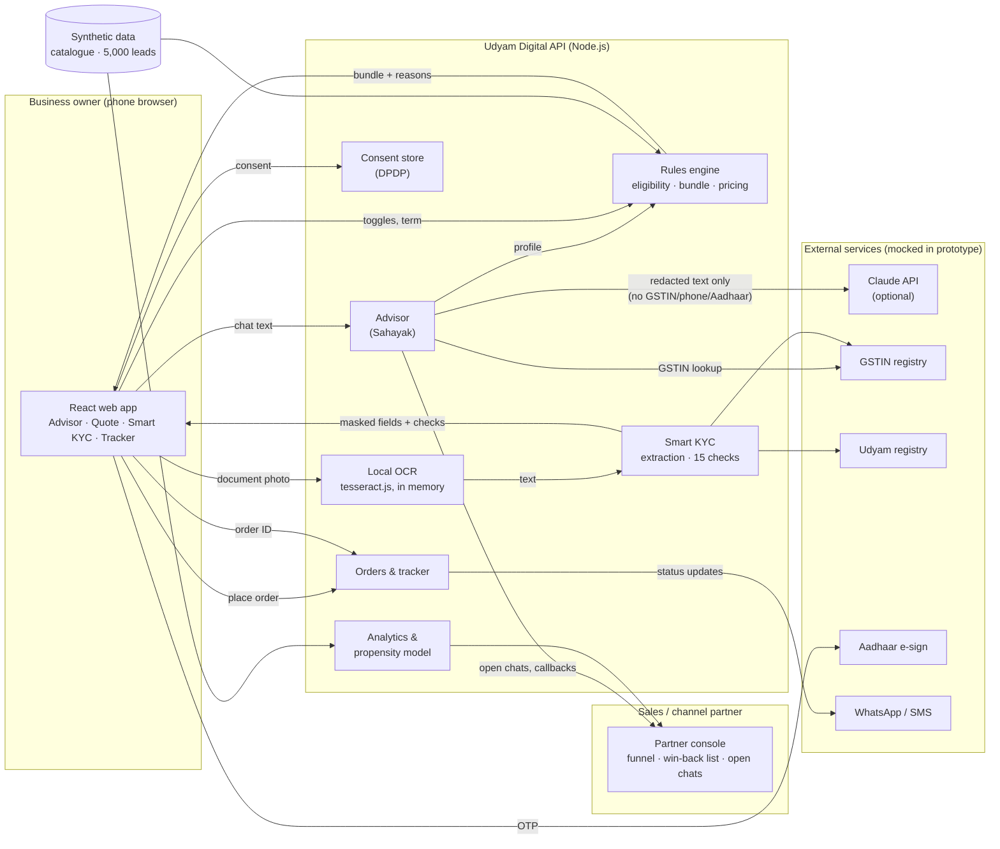

# Solution architecture

## Components and data flows

## Key design choices

1. **The LLM talks; the rules engine decides.** Claude (or the guided rules engine) only collects the business profile and explains the result. Products, quantities and prices come from `server/catalogue.js`, which enforces every catalogue rule: city tier, minimum employees and sites, GSTIN requirement and `requires_one_of` dependencies. The advisor can't recommend something the business can't buy, and prices can't be invented.
2. **Recommendations learn from customers who activated.** At startup the engine counts what the 368 activated customers in `smb_leads.csv` bought in each segment. Products bought by at least 40% of peers are included; those at 15-40% become optional add-ons (switched off by default, because "price too high" is the largest drop after needs assessment). Each reason shows the peer share.
3. **Works without the LLM.** If no API key is set, or the API fails mid-chat, the session switches to guided mode (English/Hindi, tap-to-answer). The journey never stops.
4. **The server is the source of truth for prices.** Every toggle is re-priced and re-validated on the server. Removing fibre switches off products that depend on it, with a reason.
5. **KYC is registry-first.** A GSTIN fills in name, constitution and address from the registry. Documents are checked against the registry, not just read, which is how altered certificates (K07) and cancelled GSTINs (K01) are caught.
6. **Errors become instructions.** Every failed check carries a fix: retake the photo, upload a board resolution, use a bill from the last 3 months. Only cancelled GSTINs and altered documents go to a person (manual review).
7. **Activation is planned from the catalogue.** The tracker timeline uses each product's `typical_install_days`, installed in parallel. Proactive notifications replace the 3 status-chasing calls per customer seen in the data.

## Smart KYC checks

| # | Check | Catches |
|---|---|---|
| 1 | Document present, in the right slot, readable (OCR confidence ≥ 55%, required fields found) | Blurred photos (K02, K04), wrong document |
| 2 | GSTIN structure + checksum, with OCR look-alike repair (O/0, Z/7, I/1) | Typos and altered numbers (K06, K10) |
| 3 | GSTIN found in the registry; near-match hint for the same business | Fake numbers |
| 4 | GSTIN status is Active | Cancelled or suspended registrations (K01) |
| 5 | Certificate legal and trade name equal the registry record | Altered certificates (K07) |
| 6 | Udyam number present, valid, in the registry, same business | Missing number (K01) |
| 7 | Missing Udyam certificate: look it up by name + city | K05 |
| 8 | Udyam and GST in the same state | Inconsistent records |
| 9 | Signatory ID not expired | Expired IDs |
| 10 | Signatory ID issued for this business | ID from another business |
| 11 | Signatory may sign for the constitution (proprietor, partner, director) | "Owner" signing for an LLP or company (K05, K10, K11) |
| 12 | Utility bill no older than 90 days (today = 2026-07-15) | Old bills (K11) |
| 13 | Bill in the business's name | Third-party bills |
| 14 | Bill PIN code matches the GST principal place of business | Wrong premises |
| 15 | Same business name on every document | Mixed-up applications |

## API surface

| Method & path | Purpose |
|---|---|
| `POST /api/advisor/session`, `POST /api/advisor/message` | Chat |
| `POST /api/quote` | Re-validate and price the cart (12 or 24 months) |
| `GET /api/kyc/gstin/:gstin`, `GET /api/kyc/udyam/:no` | Mock registry lookups |
| `POST /api/kyc/consent`, `DELETE /api/kyc/:consentId` | Give / withdraw consent (withdraw deletes all extracted data) |
| `POST /api/kyc/document` | OCR one photo (base64), keep extracted fields only |
| `POST /api/kyc/validate` | Run the 15 checks |
| `POST /api/kyc/esign/start`, `/verify` | Mock Aadhaar e-sign |
| `POST /api/orders`, `GET /api/orders/:id`, `POST /api/orders/:id/advance` | Order, track, demo clock |
| `POST /api/callback` | Owner asks for a person (with consent) |
| `GET /api/backoffice/summary`, `/winback`, `/advisor` | Partner console |

## Production path

| Prototype | Production |
|---|---|
| In-memory sessions, KYC, orders | PostgreSQL with column-level encryption; KYC fields in a separate, access-controlled schema |
| CSV registries | GSTN (via a GST Suvidha Provider) and Udyam APIs; DigiLocker for documents |
| Local tesseract.js | Same model on a private OCR service (data stays in India) |
| Mock e-sign / SMS / WhatsApp | Licensed eSign provider; WhatsApp Business API + DLT-registered SMS |
| Web chat | Same advisor behind a WhatsApp Business number and IVR voice (speech-to-text in Indian languages) |
| Logistic regression at startup | Retrained weekly on CRM outcomes, monitored for drift and bias by region and language |
